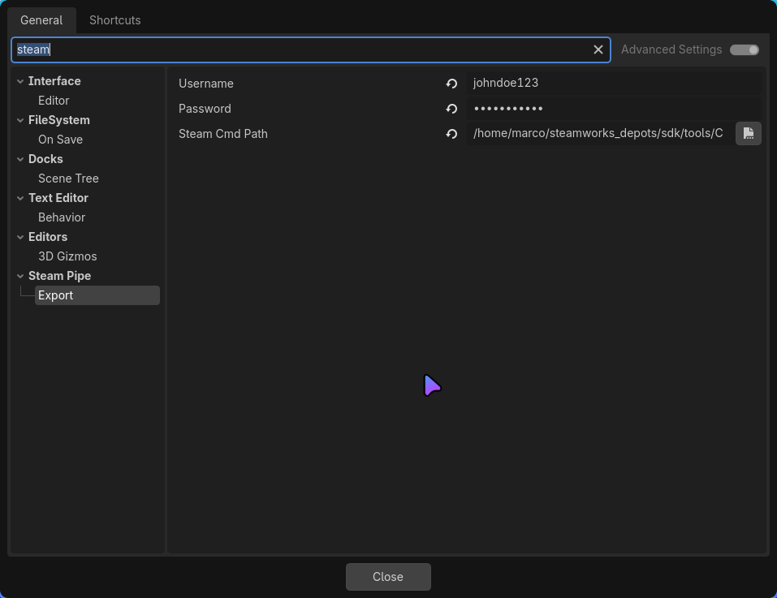
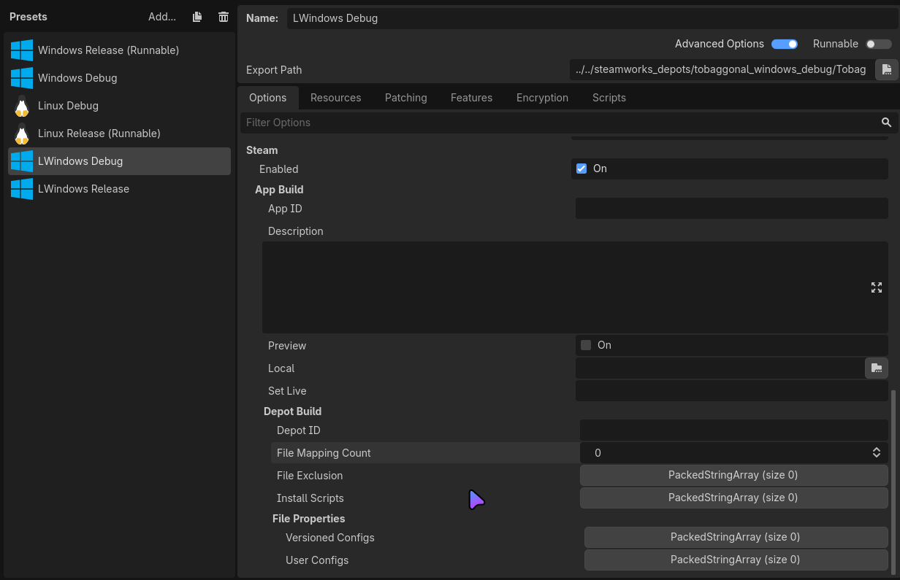

# Steam Pipe Export Plugin

## Setup

1. Open Editor Settings and go to Steam Pipe > Export
2. Enter Steamworks Username and Password
    * Password can be left empty to use cached steam credentials.
3. Enter path to steamcmd program from the steamworks sdk.

4. Configure the export options for details on what the options do see
[Uploading to Steam](https://partner.steamgames.com/doc/sdk/uploading)
> [!Note]
> The options are 1 to 1 with valves format. Except for versioned and user configs. Their respective
> PackedStringArrays correspond to the LocalPath property of FileProperties in Valve's format.

